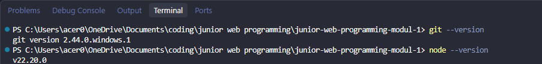
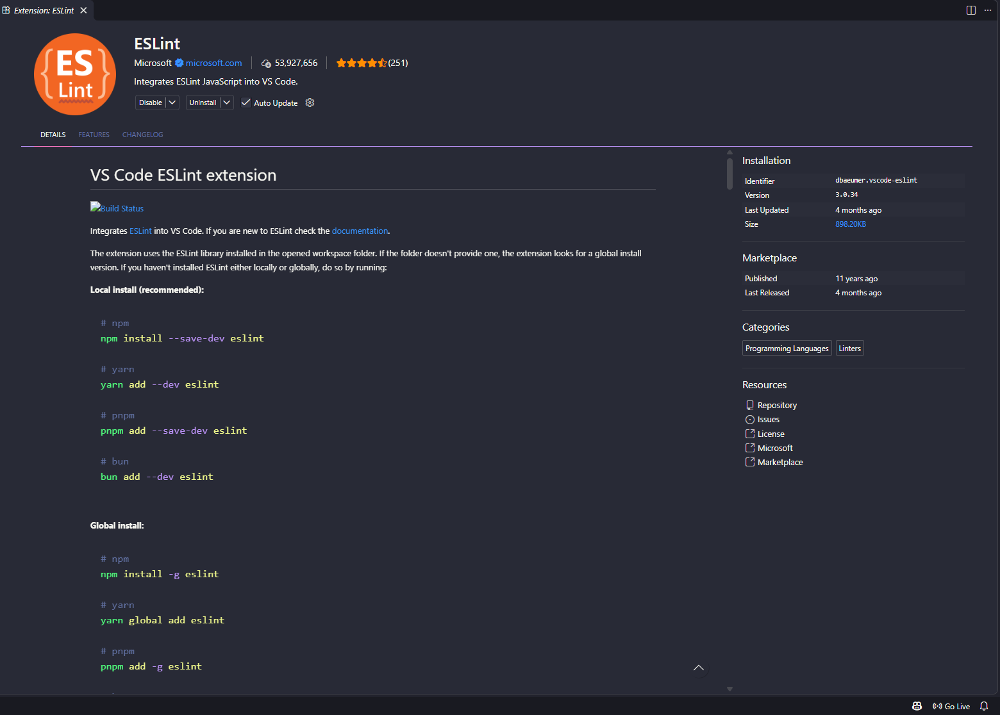
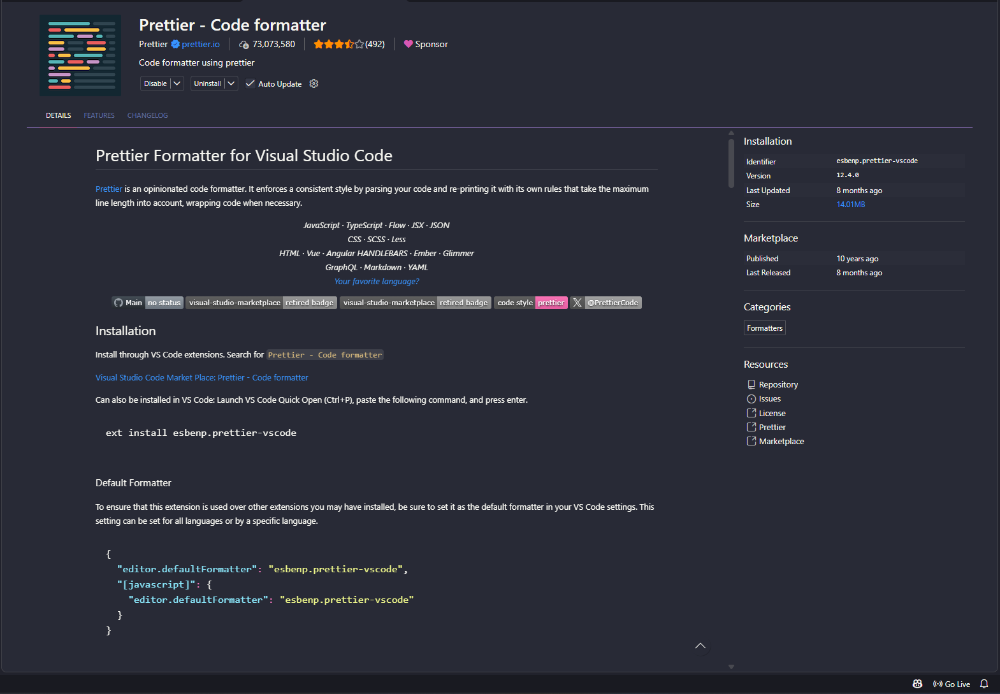
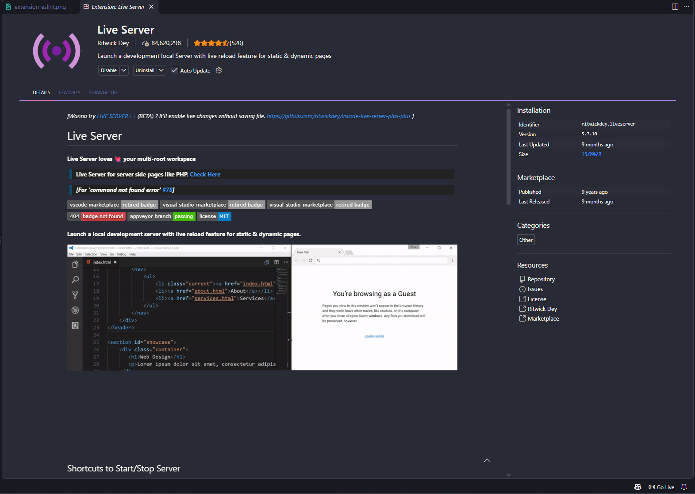
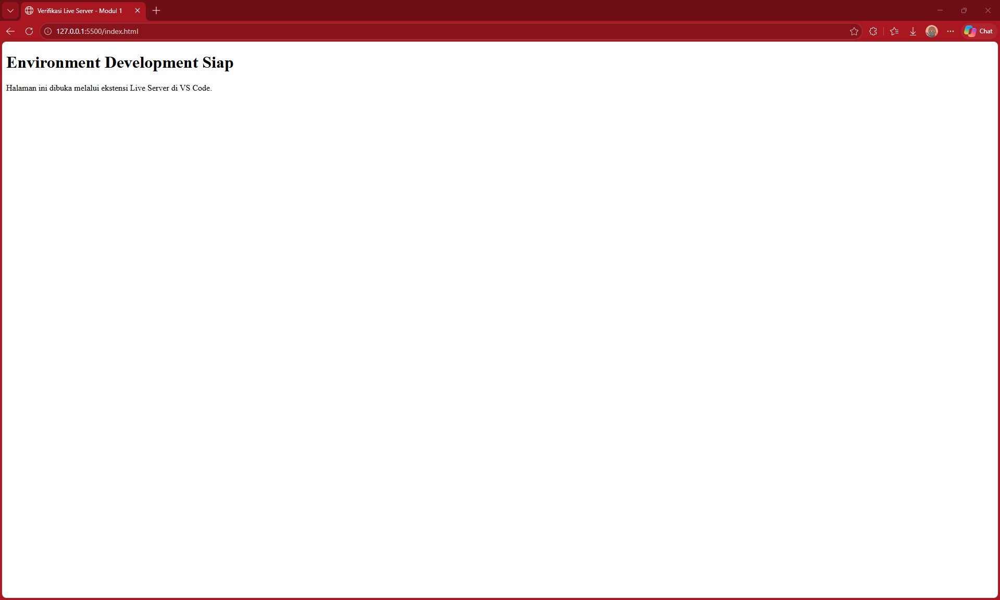

# Dokumentasi Environment Development - Modul 1

Repositori ini berisi catatan instalasi dan konfigurasi _software tools_ pemrograman web untuk **Modul 1: Instalasi Software Tools Pemrograman**.

## Daftar Tools dan Versi

| Tool / Ekstensi                 | Fungsi                                                    | Versi                               | Status                    |
| :------------------------------ | :-------------------------------------------------------- | :---------------------------------- | :------------------------ |
| Visual Studio Code              | _Code editor_ utama[cite: 1]                              | Isi versi VS Code                   | Terpasang                 |
| Google Chrome / Mozilla Firefox | _Browser_ pengujian dan _debugging_[cite: 1]              | Isi versi browser                   | Terpasang                 |
| Git                             | _Version control system_[cite: 1]                         | Isi hasil `git --version`[cite: 1]  | Terpasang                 |
| Node.js                         | _Runtime_ JavaScript (opsional/sesuai kebutuhan)[cite: 1] | Isi hasil `node --version`[cite: 1] | Terpasang / Tidak dipakai |
| Live Server                     | Menjalankan file HTML dengan _auto-reload_[cite: 1]       | Isi versi ekstensi                  | Aktif                     |
| Prettier                        | Merapikan format kode secara otomatis[cite: 1]            | Isi versi ekstensi                  | Aktif                     |
| ESLint                          | Memeriksa kualitas dan sintaks kode JavaScript[cite: 1]   | Isi versi ekstensi                  | Aktif                     |

## Langkah Instalasi dan Verifikasi

1. **Instalasi Code Editor, Browser, dan Git**: Mengunduh dan memasang VS Code, _browser_, dan Git di sistem operasi[cite: 1].
2. **Konfigurasi Ekstensi VS Code**: Memasang ekstensi _Live Server_, _Prettier_, dan _ESLint_[cite: 1].
3. **Inisialisasi Git dan Koneksi GitHub**: Membuat repositori lokal lalu menghubungkannya ke repositori GitHub[cite: 1].
4. **Verifikasi Perintah dan Live Server**: Menjalankan pengecekan versi di terminal dan membuka `index.html` melalui _Live Server_[cite: 1].

## Tangkapan Layar (Screenshots)

### Verifikasi Versi di Terminal

### Ekstensi di VS Code

### Tampilan index.html di Browser via Live Server

## Kendala dan Solusi

Secara umum, seluruh proses instalasi perangkat lunak dan konfigurasi _environment development_ berjalan lancar tanpa hambatan teknis yang berarti. Beberapa penyesuaian konfigurasi awal yang dilakukan selama proses persiapan meliputi:

- **Konfigurasi Identitas Pengguna Git**: Saat pertama kali menjalankan perintah `git commit`, Git meminta pengaturan identitas pengguna terlebih dahulu.
  - **Solusi**: Menjalankan perintah `git config --global user.name "Nama Lengkap"` dan `git config --global user.email "email@contoh.com"` agar riwayat _commit_ terhubung dengan akun GitHub.
- **Penyesuaian Default Formatter di VS Code**: Setelah memasang ekstensi _Prettier_, pemformatan otomatis belum aktif secara bawaan saat menyimpan file.
  - **Solusi**: Mengatur _Prettier_ sebagai _Default Formatter_ pada menu **Settings** di VS Code dan mengaktifkan opsi **Format On Save** agar struktur kode tetap rapi.
